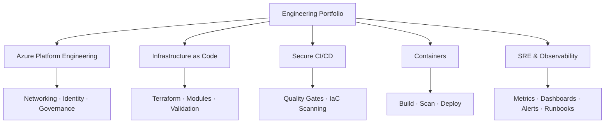

### Senior DevOps / DevSecOps Engineer · Azure Cloud · Terraform · CI/CD

**Secure infrastructure. Repeatable delivery. Observable systems.**

---

## 👋 About

I am a DevOps / DevSecOps engineer focused on Microsoft Azure, Infrastructure as Code, CI/CD automation, and cloud security. I use this GitHub portfolio to document practical implementations, architecture decisions, validation steps, and operational lessons.

My professional focus is on making infrastructure **repeatable, reviewable, secure, and easier to operate**—from Terraform plans and pipeline quality gates to container delivery and monitoring.

- 📍 Based in Saudi Arabia
- 🎯 Interested in DevOps, DevSecOps, Azure Cloud, SRE, and Platform Engineering roles
- 🧱 Focus areas: Terraform, Azure networking, CI/CD, container workflows, security scanning, and observability
- 🤝 [Connect with me on LinkedIn](https://www.linkedin.com/in/md-amirul-haque/)

> Portfolio principle: a repository should explain how to run it, how to validate it, what risks remain, and what is implemented versus planned. A green badge alone is not proof of production readiness.

## 🧭 Portfolio Architecture

## 🧰 Technology Stack

| Area | Tools and practices |
|---|---|
| ☁️ Cloud | Microsoft Azure, virtual networks, subnets, NSGs, identity and access, Key Vault concepts, Azure Monitor |
| 🏗️ IaC | Terraform, AzureRM, variables, reusable modules, state/backend concepts, plan/apply workflows |
| 🔄 CI/CD | GitHub Actions, Azure DevOps Pipelines, YAML, pipeline stages/jobs/steps, validation gates |
| 🔐 DevSecOps | Terraform validation, Checkov/TFLint workflows, secrets hygiene, least privilege, network exposure review |
| 📦 Containers | Docker, Docker Compose, Kubernetes fundamentals, image scanning concepts |
| 📊 Reliability | Prometheus, Grafana, service metrics, alerting, incident runbooks, SLI/SLO/error-budget concepts |
| 🐧 Systems | Linux, Bash, PowerShell, Git, Python fundamentals |

## 🏅 Microsoft Certifications

- **AZ-104** — Microsoft Azure Administrator
- **AZ-400** — Designing and Implementing Microsoft DevOps Solutions
- **AZ-305** — Designing Microsoft Azure Infrastructure Solutions

## 🚀 Featured Projects

### 1. 📊 SRE Observability Platform
A containerized SRE lab with FastAPI, Prometheus, Grafana dashboards, alert rules, SLO notes, and incident runbooks. The repository includes local Docker Compose instructions and a CI workflow; run it locally to validate the current behavior.

- [Repository](https://github.com/haqueamir70-coder/sre-observability-platform)
- [CI workflow](https://github.com/haqueamir70-coder/sre-observability-platform/actions)

### 2. 🛡️ Azure DevSecOps Platform
Terraform-based cloud platform work with environment configuration, network security controls, and a GitHub Actions workflow for infrastructure quality and security checks.

- [Repository](https://github.com/haqueamir70-coder/azure-devsecops-platform)
- [Workflow runs](https://github.com/haqueamir70-coder/azure-devsecops-platform/actions)
- [Threat model](https://github.com/haqueamir70-coder/azure-devsecops-platform/blob/main/docs/threat-model.md)
- [Operations runbook](https://github.com/haqueamir70-coder/azure-devsecops-platform/blob/main/docs/operations-runbook.md)

### 3. 🏢 Azure Enterprise 3-Tier Architecture
An Azure architecture and Terraform portfolio project for exploring network segmentation and application, data, security, and monitoring components. Review the repository README for scope, prerequisites, and current validation status.

- [Repository](https://github.com/haqueamir70-coder/azure-enterprise-3-tier-architecture)

### 4. ☁️ Azure Production Landing Zone
Terraform implementation covering resource organization, virtual networking, subnets, and network security controls. Use the repository documentation to review architecture choices and validation steps.

- [Repository](https://github.com/haqueamir70-coder/azure-production-landing-zone)

### 5. 🔄 Azure Terraform CI/CD
A portfolio project focused on automating Terraform workflows with GitHub Actions and Azure.

- [Repository](https://github.com/haqueamir70-coder/azure-terraform-cicd)
- [Security policy](https://github.com/haqueamir70-coder/azure-terraform-cicd/blob/main/SECURITY.md)
- [Workflow runs](https://github.com/haqueamir70-coder/azure-terraform-cicd/actions)

### 6. 🐳 Dockerized Application DevOps
Container-oriented application and delivery workflow practice.

- [Repository](https://github.com/haqueamir70-coder/dockerized-application-devops)
- [Container security checklist](https://github.com/haqueamir70-coder/dockerized-application-devops/blob/main/docs/container-security-checklist.md)
- [Workflow runs](https://github.com/haqueamir70-coder/dockerized-application-devops/actions)

### 7. 🧱 Azure Enterprise DevSecOps Platform
A separate platform engineering repository for iterating on secure Azure infrastructure and delivery practices.

- [Repository](https://github.com/haqueamir70-coder/azure-enterprise-devsecops-platform)

## 🔐 Engineering Principles

- **Infrastructure as Code:** keep infrastructure version-controlled, repeatable, and reviewable.
- **Shift security left:** format, validate, lint, and scan infrastructure changes before deployment.
- **Protect credentials:** never commit secrets, local state, or sensitive variable files; use secure identity patterns where supported.
- **Least privilege:** limit access and avoid unnecessary public network exposure.
- **Safer change management:** inspect plans and understand resource impact before applying changes.
- **Operational readiness:** provide dashboards, alerts, runbooks, smoke tests, and troubleshooting steps.
- **Evidence over claims:** report what has actually been tested and clearly document limitations.

## 🎯 Current Portfolio Priorities

- Build and document an SRE observability lab with an API, Prometheus metrics, Grafana dashboards, and alerting.
- Strengthen reusable Terraform patterns and Azure environment separation.
- Improve CI/CD security checks and authentication patterns.
- Add reproducible validation steps, architecture diagrams, and genuine screenshots to project READMEs.

## 🤝 Connect

Interested in opportunities and collaboration around Azure DevOps, DevSecOps, Terraform, cloud infrastructure, SRE, and platform engineering.

