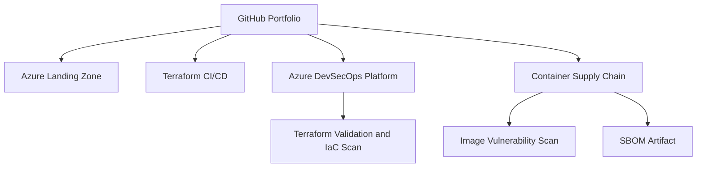

### 🔐 Senior DevSecOps Engineer | Microsoft Azure | Terraform | CI/CD

**Cloud Infrastructure · Automation · Security · Reliability**

---

## 👋 About Me

I am a **Senior DevSecOps Engineer with 5+ years of experience** across Azure cloud, CI/CD, and infrastructure automation, based on the professional summary on my LinkedIn profile. My focus is building repeatable infrastructure, improving delivery workflows, and bringing security checks earlier into the software delivery lifecycle.

I work with **Microsoft Azure, Terraform, GitHub Actions, Azure DevOps Pipelines, Linux, Docker, scripting, and cloud security practices**. My portfolio documents hands-on learning and implementation work; each repository describes what is currently implemented versus planned.

📍 Based in Saudi Arabia · Open to relevant DevOps, DevSecOps, Azure Cloud, Platform Engineering, and Infrastructure as Code opportunities, including remote roles where location and work authorization align.

## 🧭 Portfolio Delivery Map

## 🧰 Technology Stack

| Domain | Skills and tools |
|---|---|
| ☁️ **Cloud & Networking** | Microsoft Azure, Virtual Networks, subnets, Network Security Groups, identity and access concepts, Azure Key Vault, Azure Monitor |
| 🏗️ **Infrastructure as Code** | Terraform, AzureRM provider, reusable modules, variables, state/backend concepts, plan/apply workflows |
| 🔄 **CI/CD & Automation** | GitHub Actions, Azure DevOps Pipelines, YAML, pipeline stages/jobs/steps, build and deployment workflows |
| 🔐 **DevSecOps** | Shift-left security concepts, secrets management, least privilege, Terraform validation, IaC scanning with Checkov, linting with TFLint |
| 📦 **Containers & Orchestration** | Docker, Docker Compose, Kubernetes manifests and deployment fundamentals |
| 🐧 **Systems & Scripting** | Linux, Bash, PowerShell, Git, Python fundamentals |
| 📊 **Operations mindset** | Troubleshooting, logging/monitoring concepts, change review, documentation, cost and security awareness |

## 🏅 Microsoft Certifications

- **AZ-104** — Microsoft Azure Administrator
- **AZ-400** — Designing and Implementing Microsoft DevOps Solutions
- **AZ-305** — Designing Microsoft Azure Infrastructure Solutions

## 🚀 Featured Projects

### 1. 🔐 Azure DevSecOps Platform
Modular Terraform project with environment configuration, separate application and management network security groups, and a GitHub Actions workflow for formatting, validation, linting, and IaC scanning. Check the latest workflow run for validation status.

[**Explore Azure DevSecOps Platform →**](https://github.com/haqueamir70-coder/azure-devsecops-platform) · [**GitHub Actions runs →**](https://github.com/haqueamir70-coder/azure-devsecops-platform/actions) · [**Threat Model**](https://github.com/haqueamir70-coder/azure-devsecops-platform/blob/main/docs/threat-model.md) · [**Operations Runbook**](https://github.com/haqueamir70-coder/azure-devsecops-platform/blob/main/docs/operations-runbook.md)

### 2. 🏢 Azure Enterprise 3-Tier Architecture
Terraform portfolio project exploring Azure networking and selected application, data, security, and monitoring resources. Review the README for current limitations and validation requirements.

[**Explore 3-Tier Architecture →**](https://github.com/haqueamir70-coder/azure-enterprise-3-tier-architecture)

### 3. ☁️ Azure Production Landing Zone
Terraform project covering resource organization, virtual networking, subnets, NSGs, and selected identity/security components. Assess the actual configuration and validation evidence in the repository before treating it as production-ready.

[**Explore Azure Landing Zone →**](https://github.com/haqueamir70-coder/azure-production-landing-zone) · [**Architecture Decisions**](https://github.com/haqueamir70-coder/azure-production-landing-zone/blob/main/docs/architecture-decisions.md)

### 4. 🔄 Azure Terraform CI/CD
Portfolio project for connecting Terraform workflows with GitHub Actions and Azure.

[**Explore Terraform CI/CD →**](https://github.com/haqueamir70-coder/azure-terraform-cicd) · [**Security Policy**](https://github.com/haqueamir70-coder/azure-terraform-cicd/blob/main/SECURITY.md)

### 5. 🐳 Dockerized Application DevOps
Sample application and deployment configuration for practising container-based delivery workflows.

[**Explore Dockerized Application →**](https://github.com/haqueamir70-coder/dockerized-application-devops) · [**Container Security Checklist**](https://github.com/haqueamir70-coder/dockerized-application-devops/blob/main/docs/container-security-checklist.md)

### 6. 🛡️ Secure Container Supply Chain

Build, scan, and generate an SBOM for a container image using GitHub Actions. Review workflow runs and security findings before treating the pipeline as validated.

[**Explore Secure Container Supply Chain →**](https://github.com/haqueamir70-coder/dockerized-application-devops/tree/main/projects/secure-container-supply-chain) · [**Container Security Workflow →**](https://github.com/haqueamir70-coder/dockerized-application-devops/blob/main/.github/workflows/container-security.yml)

## 🔒 How I Approach DevSecOps

- **Automate infrastructure:** keep cloud configuration version-controlled, repeatable, and reviewable.
- **Build quality gates:** format and validate Terraform, lint configuration, and scan Infrastructure as Code.
- **Protect credentials:** avoid hard-coded secrets and prefer managed identity or federated identity where supported.
- **Apply least privilege:** review access permissions and network exposure before deployment.
- **Make changes safely:** inspect Terraform plans, understand resource impact, and require review before sensitive changes.
- **Document honestly:** distinguish tested implementation from roadmap items and avoid claiming production readiness without evidence.

## 🎯 Current Focus

- Improving reusable Terraform modules and environment separation.
- Strengthening CI/CD pipeline security and Azure authentication patterns.
- Improving network segmentation and cloud security posture.
- Practising container and Kubernetes deployment workflows.
- Publishing clear project documentation and validation evidence.

## 🤝 Connect

I welcome conversations about Azure DevOps, DevSecOps, Terraform, CI/CD automation, and cloud infrastructure opportunities.

