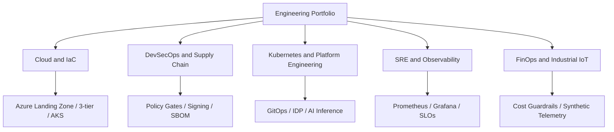

# Engineering portfolio architecture and evidence map — Architecture & Interview Guide

This repository is the profile/portfolio landing page. The diagram groups the public projects by engineering capability; it does not imply that every project is deployed in a live cloud environment.

## Architecture diagram

## Interview questions

1. 1. How do you distinguish a portfolio project from production customer experience?
2. 2. What evidence proves a Terraform project is validated?
3. 3. What is the difference between CI validation and cloud deployment?
4. 4. How do you explain an Azure landing zone architecture to a CTO?
5. 5. How do you secure GitHub Actions using OIDC?
6. 6. What controls belong in a software supply-chain security pipeline?
7. 7. How do you define SLIs, SLOs and error budgets?
8. 8. How would you estimate cloud cost and prevent budget overruns?
9. 9. How do you present a technical trade-off and its operational impact?
10. 10. How do you keep project READMEs honest about implemented, tested and planned work?

## Interview preparation note
Be ready to explain the design decision, security boundary, failure mode, operational signal and validation evidence for each answer. Clearly separate implemented code, CI-validated configuration, cloud-deployed resources and future roadmap items.
