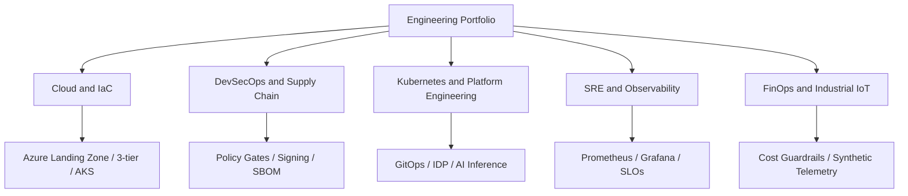

# Engineering portfolio architecture and evidence map — Architecture & Interview Guide

This repository is the profile/portfolio landing page. The diagram groups the public projects by engineering capability; it does not imply that every project is deployed in a live cloud environment.

## Architecture diagram

## Interview questions

1. 1. How do you distinguish a portfolio project from production customer experience?
2. 2. What evidence proves a Terraform project is validated?
3. 3. What is the difference between CI validation and cloud deployment?
4. 4. How do you explain an Azure landing zone architecture to a CTO?
5. 5. How do you secure GitHub Actions using OIDC?
6. 6. What controls belong in a software supply-chain security pipeline?
7. 7. How do you define SLIs, SLOs and error budgets?
8. 8. How would you estimate cloud cost and prevent budget overruns?
9. 9. How do you present a technical trade-off and its operational impact?
10. 10. How do you keep project READMEs honest about implemented, tested and planned work?

## Interview preparation note
Be ready to explain the design decision, security boundary, failure mode, operational signal and validation evidence for each answer. Clearly separate implemented code, CI-validated configuration, cloud-deployed resources and future roadmap items.

## Interview questions — suggested answers

### 1. Answer

A portfolio should show the engineering problem, architecture, implementation, tests, security decisions, operational readiness and evidence. The profile should make the strongest projects easy to inspect.

### 2. Answer

Terraform validate proves configuration is syntactically and semantically valid against initialized providers. CI logs and test results provide repeatable evidence, but not proof that cloud resources exist.

### 3. Answer

CI validation runs checks on code; deployment provisions or changes infrastructure; cloud validation tests the resulting live resources. Report these states separately.

### 4. Answer

Explain management-group/subscription boundaries, identity, policy, hub-spoke connectivity, private services, centralized logging and workload landing zones, then discuss cost and governance trade-offs.

### 5. Answer

OIDC replaces stored cloud credentials with short-lived identity tokens. Restrict the trust subject and permissions, use protected environments for sensitive operations and audit role assignments.

### 6. Answer

Include source/dependency scanning, secret scanning, image scanning, SBOM generation, signing/provenance, policy-as-code and admission verification, with clear exception handling.

### 7. Answer

An SLI is a measured service indicator, an SLO is its target over a window, and an error budget is the allowed unreliability. Use them to guide reliability and release decisions.

### 8. Answer

Use budgets, cost exports, tags, anomaly detection and owner-level allocation; prioritize changes by savings, risk and effort, and measure sustained unit-cost improvement.

### 9. Answer

State the options, constraints, risks, cost and operational consequences, explain why the selected option fits, and document what evidence would change the decision.

### 10. Answer

Keep a status matrix for implemented, CI-validated, cloud-deployed and planned items. Link workflow runs, tests and genuine screenshots; never infer deployment from a green badge.

## Complete zero-to-hero guide

See [ZERO-TO-HERO.md](./ZERO-TO-HERO.md) for the business scenario, architecture walkthrough, tool-by-tool explanations, implementation sequence, practical commands, troubleshooting playbook and additional scenario-based interview questions with answers.
